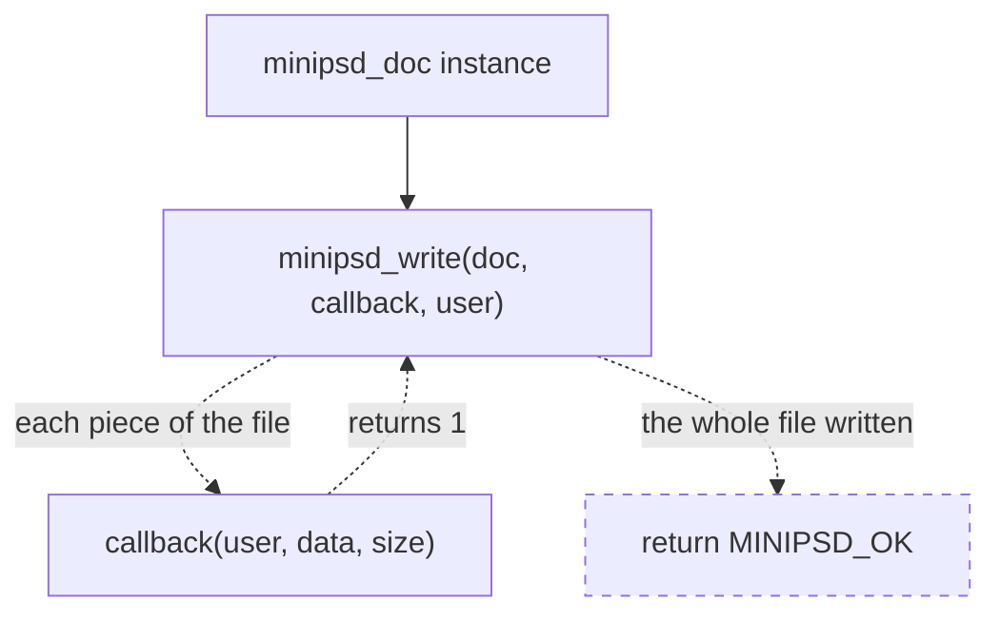
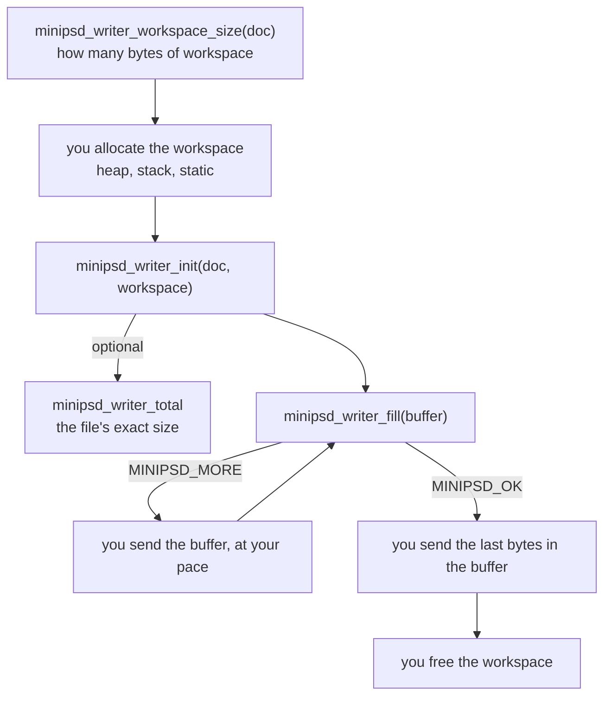
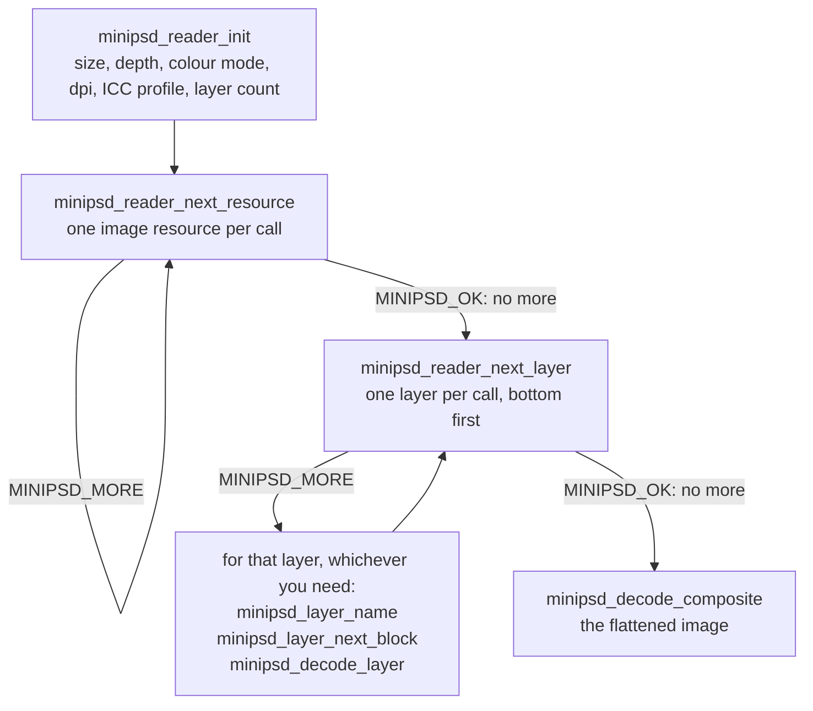
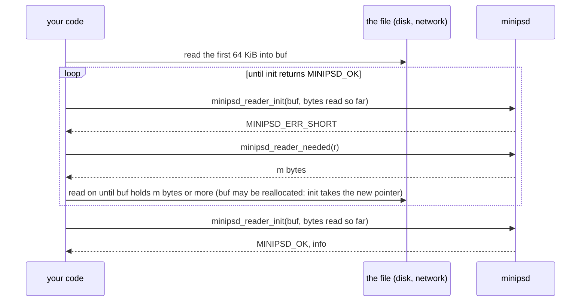

# Manual

How to use minipsd: two short programs first, then each way of writing and reading, then the
rules for memory and return codes. Every parameter and return code is documented once, in
[minipsd.h](../include/minipsd.h); the contract is [SPECIFICATION.md](SPECIFICATION.md). The
complete programs here are in [examples/](../examples/), which CI builds and runs.

| Chapter | Covers |
|---|---|
| [Getting started](#getting-started) | adding minipsd, a PSD written and read in a page of code |
| [Writing](#writing) | the order of calls; to memory, to a blocking stream, to a non-blocking one |
| [Reading](#reading) | the order of calls; a file read in parts; pixels; the composite; untrusted files |
| [Memory and ownership](#memory-and-ownership) | what you allocate, how long it must live |
| [Return codes](#return-codes) | `MINIPSD_OK`, `MINIPSD_MORE`, errors |
| [Configuration](#configuration) | `MINIPSD_STATIC`, the allocator, a build without allocation |

---

## Getting started

minipsd is two things: `include/minipsd.h` and the directory `include/minipsd/` next to it.
Copy `include/` into your project, or bring it in with CMake, pkg-config or a package
([INSTALL.md](INSTALL.md)). There is nothing to build or link: in exactly one source file,
define `MINIPSD_IMPLEMENTATION` before the include, and that file compiles the library. Every
other file includes `minipsd.h` alone.

```sh
cc -Iinclude hello_write.c -o hello_write
```

### Write a PSD

One layer, 64 x 64, to `hello.psd`. [examples/hello_write.c](../examples/hello_write.c):

```c
#define MINIPSD_IMPLEMENTATION
#include "minipsd.h"

#include <stdio.h>

static int to_file(void *file, const void *data, size_t size)
{
    return fwrite(data, 1, size, (FILE *)file) == size;   /* 0 stops the writer */
}

int main(void)
{
    static uint8_t rgba[64 * 64 * 4];   /* straight alpha, rows top down */
    minipsd_layer  layer = {"Hello", rgba, 255, 0};   /* name, pixels, opacity, hidden */
    minipsd_doc    doc   = {64, 64, 72.0, &layer, 1, NULL, 0, MINIPSD_RLE};
    FILE          *f;
    int            i, rc;

    for (i = 0; i < 64 * 64; ++i) {   /* a red-to-blue gradient */
        rgba[i * 4 + 0] = (uint8_t)(255 - i % 64 * 4);
        rgba[i * 4 + 2] = (uint8_t)(i % 64 * 4);
        rgba[i * 4 + 3] = 255;
    }

    f = fopen("hello.psd", "wb");
    if (!f) return 1;
    rc = minipsd_write(&doc, to_file, f);
    if (fclose(f) != 0 && rc == MINIPSD_OK) rc = MINIPSD_ERR_WRITE;
    if (rc != MINIPSD_OK) fprintf(stderr, "hello_write: %s\n", minipsd_error_string(rc));
    return rc != MINIPSD_OK;
}
```

More layers are more entries in the array, bottom first; a layer with `NULL` pixels is empty.

### Read a PSD

The layer names, and the flattened image as RGBA. [examples/hello_read.c](../examples/hello_read.c):

```c
#define MINIPSD_IMPLEMENTATION
#include "minipsd.h"

#include <stdio.h>
#include <stdlib.h>

int main(int argc, char **argv)
{
    uint8_t            workspace[256];   /* the reader's whole memory, the same for every file */
    uint8_t           *psd, *rgba = NULL;
    long               size;
    minipsd_reader    *r;
    minipsd_info       info;
    minipsd_layer_view layer;
    minipsd_target     target;
    char               name[256];
    int                rc;
    FILE              *f = fopen(argc > 1 ? argv[1] : "hello.psd", "rb");

    if (!f) return 1;   /* the whole file into memory */
    fseek(f, 0, SEEK_END);
    size = ftell(f);
    rewind(f);
    psd = size > 0 ? (uint8_t *)malloc((size_t)size) : NULL;
    if (!psd || fread(psd, 1, (size_t)size, f) != (size_t)size) return 1;
    fclose(f);

    rc = minipsd_reader_init(&r, psd, (size_t)size, workspace, sizeof workspace, NULL, &info);
    if (rc == MINIPSD_OK) {
        printf("%u x %u, %u layers\n", info.width, info.height, (unsigned)info.layer_count);
        while (minipsd_reader_next_layer(r, &layer) == MINIPSD_MORE)   /* bottom first */
            if (minipsd_layer_name(&layer, name, sizeof name, NULL) == MINIPSD_OK) printf("layer '%s'\n", name);

        rgba = (uint8_t *)malloc((size_t)info.width * info.height * 4);
        minipsd_target_rgba(&target, rgba, (size_t)info.width * 4);
        rc = rgba ? minipsd_decode_composite(r, &target, NULL) : MINIPSD_ERR_ALLOC;
    }
    if (rc == MINIPSD_OK)
        printf("first pixel: %u %u %u %u\n", rgba[0], rgba[1], rgba[2], rgba[3]);
    else
        fprintf(stderr, "hello_read: %s\n", minipsd_error_string(rc));
    free(rgba);
    free(psd);
    return rc != MINIPSD_OK;
}
```

That is all most programs need. The rest of this manual is for the cases these two do not
cover: no heap, a non-blocking target, a file arriving in parts, pixels in a layout of your own.

## Writing

A document is a `minipsd_doc` and its layers; the pixels stay where the application keeps them
and are read in place. minipsd does no I/O: it hands bytes to a callback or puts them into a
buffer of yours. Two ways produce the file, and both give the same bytes:

| You have | Use |
|---|---|
| a heap and a target that takes bytes as they come (a file, a blocking socket, a hash) | `minipsd_write` with a callback |
| no heap, a non-blocking target, or a buffer for the whole file | the pull writer, `minipsd_writer_*` |

In the diagrams, solid is what you write or call; dashed is what minipsd does.

**One call, `minipsd_write`.** You write a callback and call `minipsd_write`; minipsd calls the
callback with each piece of the file, in order, and returns when the whole file has gone
through it. A piece is at most 4 KiB, the buffer `minipsd_write` keeps on its stack; it has
nothing to do with the target. A callback that returns 0 stops the write with
`MINIPSD_ERR_WRITE`.



**The pull writer.** You own the memory and the pace: the writer lives in a workspace of
yours, and each `minipsd_writer_fill` call produces the next bytes into a buffer of yours, then
returns at once. Between calls you do anything, such as wait until a socket is writable:



Nothing here is dashed: minipsd never calls your code, you call it, which is what makes the pull
writer fit any target.

The examples below write this document:

```c
minipsd_layer layers[2] = {
    { "Template", rgba, 255, 0 },   /* name, pixels (width * height * 4, straight alpha), opacity, hidden */
    { "Layer",    NULL, 255, 0 },   /* an empty layer above it */
};
minipsd_doc doc = { width, height, 300.0, layers, 2, NULL, 0, MINIPSD_RLE };
```

The document, its pixels and the workspace must stay valid, and unchanged, until the last byte
is out: the writer sized everything from them at the start.

### To a blocking stream

`minipsd_write` drives the pull writer to the end and hands each piece, up to 4 KiB, to the
callback; a callback that returns 0 stops it with `MINIPSD_ERR_WRITE`. A file is
[Write a PSD](#write-a-psd) above. A blocking descriptor, such as a pipe or a socket, may take
less than it is given, so its callback loops:

```c
static int to_fd(void *user, const void *data, size_t size)
{
    const int      fd = *(const int *)user;
    const uint8_t *p  = data;
    while (size > 0) {
        ssize_t n = write(fd, p, size);
        if (n < 0 && errno == EINTR) continue;
        if (n <= 0) return 0;   /* the target failed */
        p    += n;
        size -= (size_t)n;
    }
    return 1;
}

rc = minipsd_write(&doc, to_fd, &fd);
```

`minipsd_write` allocates its workspace once, through `MINIPSD_MALLOC`. Without a heap, write the
same loop over `minipsd_writer_fill`, on a workspace of your own.

### To memory

The pull writer knows the file's size before writing it, so one buffer of exactly that size takes
the whole file in one call:

```c
/* The file for doc in a new buffer of exactly its size, *size bytes; NULL on failure. */
static uint8_t *write_to_memory(const minipsd_doc *doc, size_t *size)
{
    minipsd_writer *w;
    size_t          need;
    void           *workspace;
    uint8_t        *file = NULL;

    if (minipsd_writer_workspace_size(doc, &need) != MINIPSD_OK) return NULL;   /* refused */
    workspace = malloc(need);                                    /* or the stack, a pool, ... */
    if (workspace && minipsd_writer_init(&w, doc, workspace, need) == MINIPSD_OK) {
        uint64_t total = minipsd_writer_total(w);
        if ((size_t)total == total) file = malloc((size_t)total);   /* fits a size_t */
        if (file && minipsd_writer_fill(w, file, (size_t)total, size) != MINIPSD_OK) {
            free(file);
            file = NULL;
        }
    }
    free(workspace);                                             /* the writer ends with it */
    return file;
}
```

There is nothing to release in minipsd: the writer lives in the workspace. The whole program:
[examples/write_memory.c](../examples/write_memory.c).

### To a non-blocking stream

The writer never waits. Whenever the target can take bytes, send what is pending; when nothing
is pending, pull the next chunk. A target that takes only part of the chunk is fine: the rest
stays pending in your buffer. With a descriptor set to `O_NONBLOCK`:

```c
uint8_t chunk[64 * 1024];   /* a few rows: a call re-encodes the row it stops in */
size_t  have = 0, sent = 0;
int     rc   = MINIPSD_MORE;
ssize_t n;

/* each time poll() says fd is writable: */
if (sent == have && rc == MINIPSD_MORE) {
    rc = minipsd_writer_fill(w, chunk, sizeof chunk, &have);   /* rc < 0: an error */
    sent = 0;
}
n = write(fd, chunk + sent, have - sent);                      /* may take less, or nothing */
if (n > 0) sent += (size_t)n;
else if (n < 0 && errno != EAGAIN && errno != EWOULDBLOCK) { /* the target failed */ }

/* finished when rc == MINIPSD_OK and sent == have */
```

`minipsd_writer_total` gives the size up front, for a `Content-Length` header or a progress bar.
The whole program, an `O_NONBLOCK` pipe driven by `poll` with its reading end in the same loop:
[examples/write_nonblocking.c](../examples/write_nonblocking.c).

## Reading

The reader describes a file and decodes its pixels, layers and composite. It works on bytes you
already hold, never copies them, and allocates nothing: its workspace has a fixed size, so it can
live on the stack. Everything it returns points into those bytes, which must stay where they
are, unchanged, while any of it is used.

A whole file, everything read, top to bottom:



Only `init` is required. Every step below it is independent of the others, so skip the ones you
do not need: a file manager stops after `init`; a viewer goes straight to the composite, as
[Read a PSD](#read-a-psd) could; a layer exporter never decodes the composite. Resources and
layers are iterators: each call returns `MINIPSD_MORE` with one item, then `MINIPSD_OK` when
there are no more. Calling `init` again restarts both.

### A file read in parts

Skip this section if your program holds the whole file in memory, as
[Read a PSD](#read-a-psd) does: then `MINIPSD_ERR_SHORT` means a truncated file. It is for a
file that arrives in parts, such as a download, or a large file you would rather not read whole
to show its size and layer names.

The reader can start on a prefix of the file. Any call that runs past the end of your buffer
returns `MINIPSD_ERR_SHORT`, and `minipsd_reader_needed` says how long the buffer must be for
that call to get further. For `minipsd_reader_init`, which needs the bytes up to the layer count,
it goes like this:



The same holds for `next_layer` and the decode calls: on `MINIPSD_ERR_SHORT`, read up to
`needed`, call `init` on the longer buffer and repeat the iteration up to where it stopped.
`needed` is the least length for the next step only, and each layer record reveals its own length
in about three steps, so read in larger chunks (64 KiB or more) and use `needed` as the floor.
Layer names need the whole records section; a layer whose pixel data is not in the buffer yet
still comes back, with that channel's view `data == NULL`.

### Pixels go where you say

A layer decodes into a `minipsd_target`: for each of R, G, B and A a pointer, a pixel step and a
row step, so interleaved RGBA, BGRA, planar, bottom-up or a spot inside a larger canvas are all
the same call. A `NULL` plane is not written. The size comes from the layer's rectangle; the
library writes exactly those samples:

```c
uint32_t       w = (uint32_t)(layer.right - layer.left), h = (uint32_t)(layer.bottom - layer.top);
uint8_t       *rgba = malloc((size_t)w * h * 4);
minipsd_target t;

minipsd_target_rgba(&t, rgba, (size_t)w * 4);
rc = minipsd_decode_layer(r, &layer, &t, NULL);   /* NULL: every row */
```

BGRA is the same buffer with the planes swapped:

```c
minipsd_target_rgba(&t, bgra, (size_t)w * 4);
t.channel[MINIPSD_CH_R].data = bgra + 2;
t.channel[MINIPSD_CH_B].data = bgra;
```

Pixels come as stored: straight alpha, the layer's opacity and visibility left in the view. A
`minipsd_decode_opts` with `y_first` and `y_count` decodes a band of rows into the target's first
row, so a huge layer can go through a small buffer in strips. Only 8-bit RGB files decode
(`MINIPSD_ERR_UNSUPPORTED` otherwise; every other file is still described).

### The composite

The composite is the flattened image a viewer that ignores layers shows: the full canvas,
`info.width` by `info.height`. `minipsd_decode_composite` takes the same target and bands. The
file stores it matted against white; it comes back un-matted, straight alpha like the layers,
which needs the target's `A` plane since the alpha is read back from there. Set `keep_matte`
for the bytes as stored, for instance to show them on white as they are.
[Read a PSD](#read-a-psd) above decodes it; [examples/read_file.c](../examples/read_file.c)
goes further: every layer with its name, blend mode and blocks, and how many pixels of each are
visible.

### Untrusted files

Every length is checked; a malformed file is `MINIPSD_ERR_FORMAT`. Pass a `minipsd_limits` to
refuse what is too large before it costs anything, with `MINIPSD_ERR_LIMIT`, distinct from a
malformed file:

| Field | Checked by | 0 means |
|---|---|---|
| `max_side` | `init` for the canvas, `next_layer` for each layer | 30 000 for the canvas; no limit for layers, which may reach past it |
| `max_layers` | `init` | 32 767, the format's cap |
| `max_decoded_bytes` | each `decode_*` call, before it writes: width x rows x planes | no limit |

The byte limit is per call, so a layer larger than it can still be decoded in bands of rows.

## Memory and ownership

minipsd allocates only inside `minipsd_write`, and frees it before returning. Everything else is
yours, and minipsd only borrows it:

| You provide | How much | Must live |
|---|---|---|
| the document and its pixels (writer) | what the document is | until the last byte is out |
| the writer's workspace | `minipsd_writer_workspace_size`, per document | while the writer is used |
| the output buffer of `minipsd_writer_fill` | any size; 64 KiB is plenty | the call |
| the PSD's bytes (reader) | the file, or its start | while the reader or anything it returned is used |
| the reader's workspace | `minipsd_reader_workspace_size`, the same for every file (256 bytes is enough) | while the reader is used |
| the decoded pixels | the layer's rectangle, or the band | the call |

There is nothing to release: the writer and the reader live inside their workspaces, so freeing
or reusing the workspace ends them. Any memory will do (stack, static, heap, a pool), at any
alignment. No state is global, so separate threads never interact; one workspace serves one
writer or reader at a time. The full table, every view included, is in the spec's
[Memory and ownership](SPECIFICATION.md#memory-and-ownership).

## Return codes

Every function that can fail returns an `int`, in three groups:

| Value | Meaning |
|---|---|
| `MINIPSD_OK` (0) | done: the call succeeded, or an iteration is over |
| `MINIPSD_MORE` (1) | not finished, and nothing is wrong: `writer_fill` has more bytes, an iterator returned an item, a name did not fit |
| negative, `MINIPSD_ERR_*` | an error; `minipsd_error_string(rc)` gives a short English text |

So `rc < 0` is the test for an error. `MINIPSD_ERR_SHORT` and `MINIPSD_ERR_LIMIT` are errors that
need not mean a bad file: the first asks for more bytes, the second is your own limit. Which
codes each function returns is listed with it in [minipsd.h](../include/minipsd.h).

## Configuration

Define before the `#include` in the implementation file:

| Macro | Effect |
|---|---|
| `MINIPSD_STATIC` | every function `static`, private to that file: several copies never clash |
| `MINIPSD_MALLOC` / `MINIPSD_FREE` | replace `malloc` / `free`; define both |
| `MINIPSD_NO_MALLOC` | no allocation at all, and no `<stdlib.h>`: `minipsd_write` goes, the pull writer and the reader stay |
