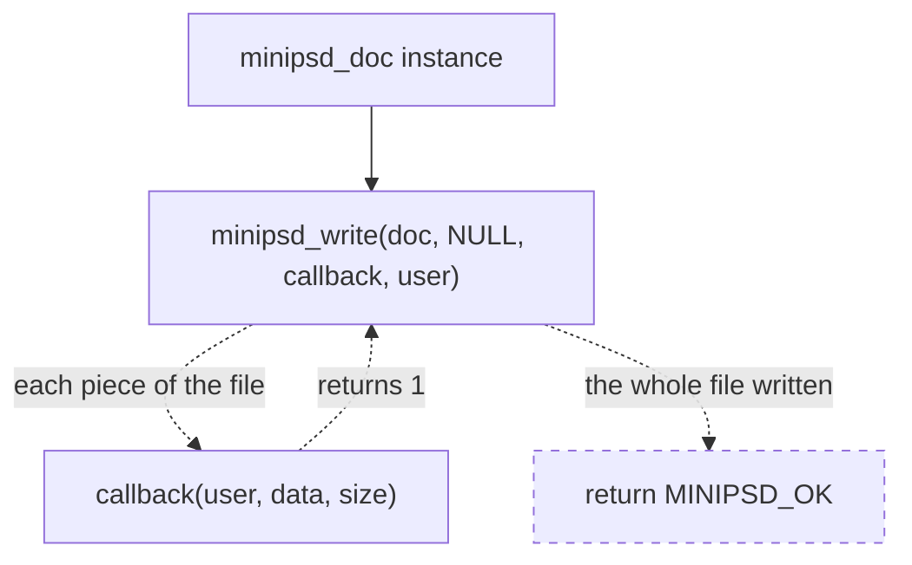
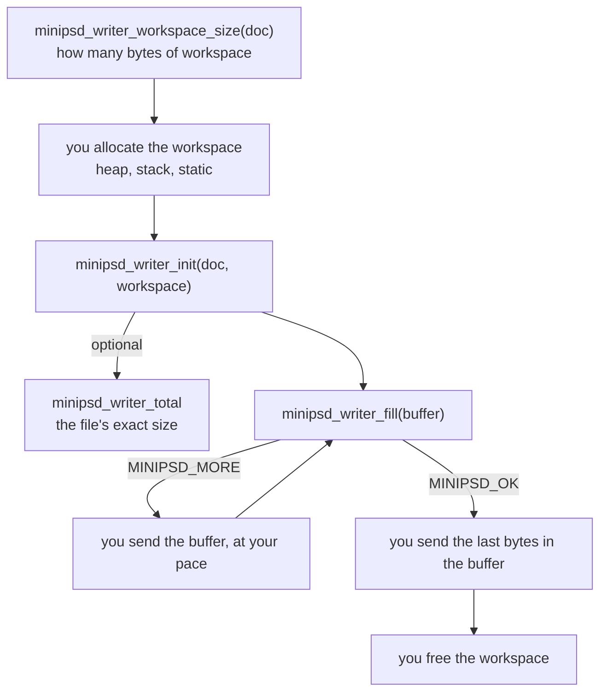
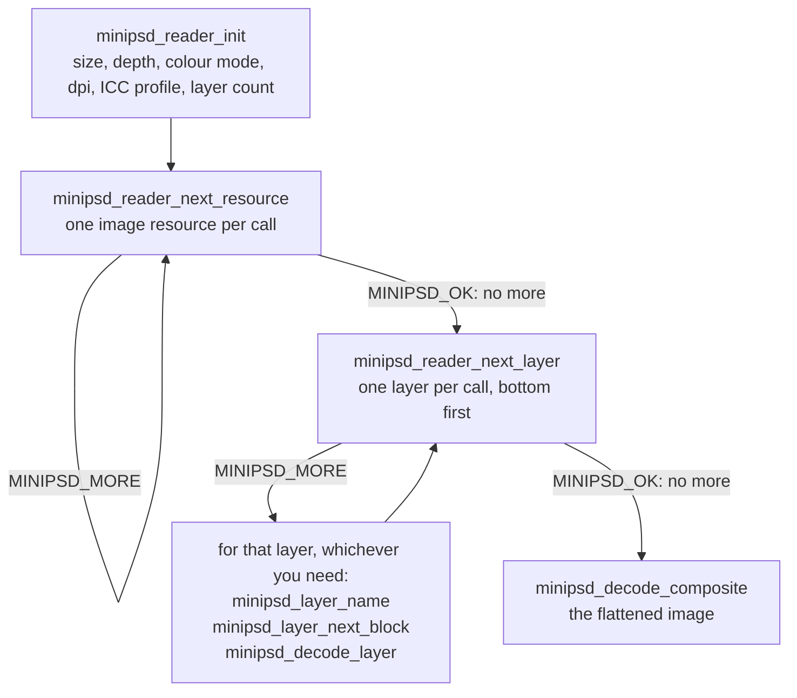
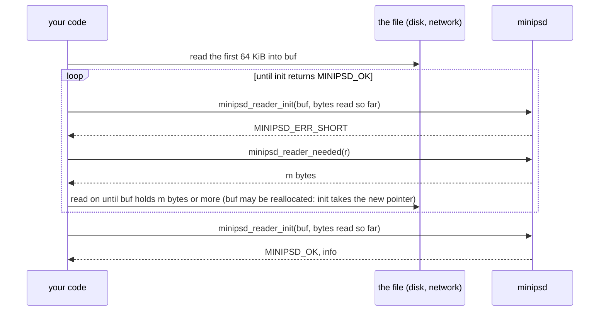
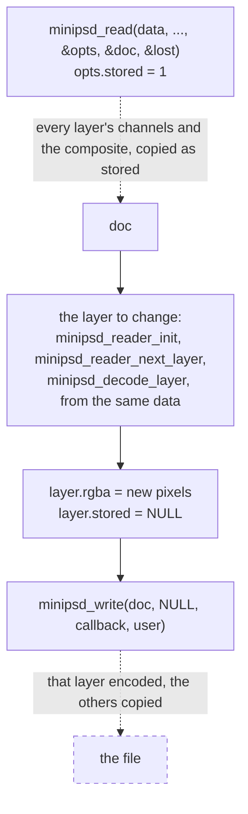

# Manual

How to use minipsd: two short programs first, then each way of writing and reading, then the
rules for memory and return codes. Every parameter and return code is documented once, in
[minipsd.h](../include/minipsd.h); the contract is [SPECIFICATION.md](SPECIFICATION.md). The
complete programs here are in [examples/](../examples/), which CI builds and runs.

| Chapter | Covers |
|---|---|
| [Getting started](#getting-started) | adding minipsd, a PSD written and read in a page of code |
| [Writing](#writing) | the order of calls; to memory, to a blocking stream, to a non-blocking one |
| [Reading](#reading) | the order of calls; a file read in parts; pixels; the composite; untrusted files |
| [Round trip](#round-trip) | a file read into a document, changed, written back; what is kept, what is lost |
| [Memory and ownership](#memory-and-ownership) | what you allocate, how long it must live |
| [Return codes](#return-codes) | `MINIPSD_OK`, `MINIPSD_MORE`, errors |
| [Configuration](#configuration) | `MINIPSD_STATIC`, the allocator, a build without allocation |

---

## Getting started

minipsd is two things: `include/minipsd.h` and the directory `include/minipsd/` next to it.
Copy `include/` into your project, or bring it in with CMake, pkg-config or a package
([INSTALL.md](INSTALL.md)). There is nothing to build or link: in exactly one source file,
define `MINIPSD_IMPLEMENTATION` before the include, and that file compiles the library. Every
other file includes `minipsd.h` alone.

```sh
cc -Iinclude hello_write.c -o hello_write
```

### Write a PSD

One layer, 64 x 64, to `hello.psd`. [examples/hello_write.c](../examples/hello_write.c):

```c
#define MINIPSD_IMPLEMENTATION
#include "minipsd.h"

#include <stdio.h>

static int to_file(void *file, const void *data, size_t size)
{
    return fwrite(data, 1, size, (FILE *)file) == size;   /* 0 stops the writer */
}

int main(void)
{
    static uint8_t rgba[64 * 64 * 4];   /* straight alpha, rows top down */
    /* Fields left out are zero, the defaults: visible, the full canvas, RLE. */
    minipsd_layer  layer = {.name = "Hello", .rgba = rgba, .opacity = 255};
    minipsd_doc    doc   = {.width = 64, .height = 64, .dpi = 72.0, .layers = &layer, .layer_count = 1};
    FILE          *f;
    int            i, rc;

    for (i = 0; i < 64 * 64; ++i) {   /* a red-to-blue gradient */
        rgba[i * 4 + 0] = (uint8_t)(255 - i % 64 * 4);
        rgba[i * 4 + 2] = (uint8_t)(i % 64 * 4);
        rgba[i * 4 + 3] = 255;
    }

    f = fopen("hello.psd", "wb");
    if (!f) return 1;
    rc = minipsd_write(&doc, NULL, to_file, f);
    if (fclose(f) != 0 && rc == MINIPSD_OK) rc = MINIPSD_ERR_WRITE;
    if (rc != MINIPSD_OK) fprintf(stderr, "hello_write: %s\n", minipsd_error_string(rc));
    return rc != MINIPSD_OK;
}
```

More layers are more entries in the array, bottom first; a layer with `NULL` pixels is empty.

### Read a PSD

The layer names, and the flattened image as RGBA. [examples/hello_read.c](../examples/hello_read.c):

```c
#define MINIPSD_IMPLEMENTATION
#include "minipsd.h"

#include <stdio.h>
#include <stdlib.h>

int main(int argc, char **argv)
{
    uint8_t            workspace[256];   /* the reader's whole memory, the same for every file */
    uint8_t           *psd, *rgba = NULL;
    long               size;
    minipsd_reader    *r;
    minipsd_info       info;
    minipsd_layer_view layer;
    minipsd_target     target;
    char               name[256];
    int                rc;
    FILE              *f = fopen(argc > 1 ? argv[1] : "hello.psd", "rb");

    if (!f) return 1;   /* the whole file into memory */
    fseek(f, 0, SEEK_END);
    size = ftell(f);
    rewind(f);
    psd = size > 0 ? (uint8_t *)malloc((size_t)size) : NULL;
    if (!psd || fread(psd, 1, (size_t)size, f) != (size_t)size) return 1;
    fclose(f);

    rc = minipsd_reader_init(&r, psd, (size_t)size, workspace, sizeof workspace, NULL, &info);
    if (rc == MINIPSD_OK) {
        printf("%u x %u, %u layers\n", info.width, info.height, (unsigned)info.layer_count);
        while (minipsd_reader_next_layer(r, &layer) == MINIPSD_MORE)   /* bottom first */
            if (minipsd_layer_name(&layer, name, sizeof name, NULL) == MINIPSD_OK) printf("layer '%s'\n", name);

        rgba = (uint8_t *)malloc((size_t)info.width * info.height * 4);
        minipsd_target_rgba(&target, rgba, (size_t)info.width * 4);
        rc = rgba ? minipsd_decode_composite(r, &target, NULL) : MINIPSD_ERR_ALLOC;
    }
    if (rc == MINIPSD_OK)
        printf("first pixel: %u %u %u %u\n", rgba[0], rgba[1], rgba[2], rgba[3]);
    else
        fprintf(stderr, "hello_read: %s\n", minipsd_error_string(rc));
    free(rgba);
    free(psd);
    return rc != MINIPSD_OK;
}
```

That is all most programs need. The rest of this manual is for the cases these two do not
cover: no heap, a non-blocking target, a file arriving in parts, pixels in a layout of your own.

## Writing

A document is a `minipsd_doc` and its layers; the pixels stay where the application keeps them
and are read in place. minipsd does no I/O: it hands bytes to a callback or puts them into a
buffer of yours. Two ways produce the file, and both give the same bytes:

| You have | Use |
|---|---|
| a heap and a target that takes bytes as they come (a file, a blocking socket, a hash) | `minipsd_write` with a callback |
| no heap, a non-blocking target, or a buffer for the whole file | the pull writer, `minipsd_writer_*` |

In the diagrams, solid is what you write or call; dashed is what minipsd does.

**One call, `minipsd_write`.** You write a callback and call `minipsd_write`; minipsd calls the
callback with each piece of the file, in order, and returns when the whole file has gone
through it. A piece is at most 4 KiB, the buffer `minipsd_write` keeps on its stack; it has
nothing to do with the target. A callback that returns 0 stops the write with
`MINIPSD_ERR_WRITE`.



**The pull writer.** You own the memory and the pace: the writer lives in a workspace of
yours, and each `minipsd_writer_fill` call produces the next bytes into a buffer of yours, then
returns at once. Between calls you do anything, such as wait until a socket is writable:



Nothing here is dashed: minipsd never calls your code, you call it, which is what makes the pull
writer fit any target.

The examples below write this document:

```c
minipsd_layer layers[2] = {
    { .name = "Template", .rgba = rgba, .opacity = 255 },   /* width * height * 4, straight alpha */
    { .name = "Layer", .opacity = 255 },                    /* an empty layer above it */
};
minipsd_doc doc = { .width = width, .height = height, .dpi = 300.0, .layers = layers, .layer_count = 2 };
```

Name the fields. The structs only grow at the end, and every field left out is zero, which is
the default: visible, RLE, and a layer that covers the full canvas. A layer of another size sets
its rectangle on the canvas, which may reach past the edges; `rgba` then holds that rectangle:

```c
/* 64 x 32 pixels, its top-left corner at x 20, y 10 */
minipsd_layer logo = { .name = "Logo", .rgba = logo_rgba, .opacity = 255,
                       .top = 10, .left = 20, .bottom = 42, .right = 84 };
```

A group is two records around its layers, bottom first: a divider, then the layers, then the
group itself, which carries its name, visibility and mode (Pass Through unless `blend_mode` says
otherwise). A layer mask is one byte per pixel over a rectangle of its own, 255 where the layer
shows:

```c
minipsd_mask  fade   = { .top = 0, .left = 0, .bottom = 32, .right = 64, .pixels = ramp };
minipsd_layer layers[4] = {
    { .name = "</Layer group>", .opacity = 255, .section_divider_type = MINIPSD_SECTION_GROUP_END },
    { .name = "Logo", .rgba = logo_rgba, .opacity = 255, .bottom = 32, .right = 64, .mask = &fade },
    { .name = "Shadow", .rgba = shadow_rgba, .opacity = 128, .bottom = 32, .right = 64 },
    { .name = "Branding", .opacity = 255, .section_divider_type = MINIPSD_SECTION_GROUP },
};
```

A 16-bit document sets `depth`. Every sample, of the layers, the masks and the composite, is then
a `uint16_t` in host order, 0 to 65535; the pointers keep their type, so cast:

```c
uint16_t     *deep = malloc((size_t)width * height * 4 * sizeof *deep);   /* straight alpha */
minipsd_layer layer = { .name = "Deep", .rgba = (const uint8_t *)deep, .opacity = 255 };
minipsd_doc   doc = { .width = width, .height = height, .dpi = 300.0, .layers = &layer, .layer_count = 1,
                      .depth = 16 };
```

A document wider or taller than 30 000 px, a long webtoon strip say, is written as a PSB, the
large document format, up to 300 000 px a side; nothing else in it changes:

```c
doc.format = MINIPSD_PSB;   /* 0 or MINIPSD_PSD: a PSD, refused above 30 000 px (MINIPSD_ERR_SIZE) */
```

"Blend If" (a layer's blending ranges) hides the layer where its own pixels, or those beneath it,
fall outside a range. The first range is the composite grey's, then one per channel; a point
split in Photoshop (Alt-drag) has two different halves:

```c
/* show the layer only where what lies beneath is darker than 200, fading out from 180 */
minipsd_blending_range blend_if[1] = { { .source      = { .black = { 0, 0 },     .white = { 255, 255 } },
                                         .destination = { .black = { 0, 0 },     .white = { 180, 200 } } } };
logo.blending_ranges      = blend_if;
logo.blending_range_count = 1;
```

Many programs that read PSD do not read PSB, so choose it when the size needs it. A document read
from a file is in that file's format, and so is everything it keeps. To write it in the other
one, ask at the write call; the kept bytes are translated on the way out, nothing is copied first:

```c
const minipsd_write_opts as_psb = { .format = MINIPSD_PSB };
rc = minipsd_write(doc, &as_psb, to_file, f);   /* a PSD read from disk, written as a PSB */
```

Going the other way, a PSB that a PSD cannot hold is `MINIPSD_ERR_SIZE`, and the few blocks whose
translation is not verified yet are `MINIPSD_ERR_UNSUPPORTED`, both before a byte is written.

Channels are PackBits RLE by default, or raw. ZIP, as Photoshop writes its 16-bit layers, needs a
deflate of yours, zlib's here, since minipsd implements none; the composite stays RLE:

```c
static int deflate_zlib(void *user, const uint8_t *src, size_t src_size, uint8_t *dst, size_t *dst_size)
{
    uLongf n = *dst_size;
    int    rc = compress2(dst, &n, src, (uLong)src_size, 6);
    (void)user;
    *dst_size = n;
    return rc != Z_OK;
}

const minipsd_write_opts zip = { .deflate = deflate_zlib };
doc.compression = MINIPSD_ZIP_PREDICTED;   /* or MINIPSD_ZIP, without prediction */
rc = minipsd_write(&doc, &zip, to_file, f);
```

Each channel is deflated twice, once to size it and once to write it, so the same input must give
the same bytes, as zlib's do.

The composite, the flattened image that viewers and thumbnails show, is yours to render when
the layers use anything beyond plain "over" (libvips does most of it, see
[Working with libvips](SPECIFICATION.md#working-with-libvips)). Give it in straight alpha, the
full canvas; the writer mattes it as the file stores it:

```c
doc.composite = flattened;   /* width * height * 4, straight alpha; NULL: composed, a best effort */
```

Without one, the writer composes the visible layers with "over" at their opacity: enough for a
preview, with no guarantee for anything else.

The document, its pixels and the workspace must stay valid, and unchanged, until the last byte
is out: the writer sized everything from them at the start.

### To a blocking stream

`minipsd_write` drives the pull writer to the end and hands each piece, up to 4 KiB, to the
callback; a callback that returns 0 stops it with `MINIPSD_ERR_WRITE`. A file is
[Write a PSD](#write-a-psd) above. A blocking descriptor, such as a pipe or a socket, may take
less than it is given, so its callback loops:

```c
static int to_fd(void *user, const void *data, size_t size)
{
    const int      fd = *(const int *)user;
    const uint8_t *p  = data;
    while (size > 0) {
        ssize_t n = write(fd, p, size);
        if (n < 0 && errno == EINTR) continue;
        if (n <= 0) return 0;   /* the target failed */
        p    += n;
        size -= (size_t)n;
    }
    return 1;
}

rc = minipsd_write(&doc, NULL, to_fd, &fd);
```

`minipsd_write` allocates its workspace once, through `MINIPSD_MALLOC`. Without a heap, write the
same loop over `minipsd_writer_fill`, on a workspace of your own.

### To memory

The pull writer knows the file's size before writing it, so one buffer of exactly that size takes
the whole file in one call:

```c
/* The file for doc in a new buffer of exactly its size, *size bytes; NULL on failure. */
static uint8_t *write_to_memory(const minipsd_doc *doc, size_t *size)
{
    minipsd_writer *w;
    size_t          need;
    void           *workspace;
    uint8_t        *file = NULL;

    if (minipsd_writer_workspace_size(doc, NULL, &need) != MINIPSD_OK) return NULL;   /* refused */
    workspace = malloc(need);                                    /* or the stack, a pool, ... */
    if (workspace && minipsd_writer_init(&w, doc, NULL, workspace, need) == MINIPSD_OK) {
        uint64_t total = minipsd_writer_total(w);
        if ((size_t)total == total) file = malloc((size_t)total);   /* fits a size_t */
        if (file && minipsd_writer_fill(w, file, (size_t)total, size) != MINIPSD_OK) {
            free(file);
            file = NULL;
        }
    }
    free(workspace);                                             /* the writer ends with it */
    return file;
}
```

There is nothing to release in minipsd: the writer lives in the workspace. The whole program:
[examples/write_memory.c](../examples/write_memory.c).

### To a non-blocking stream

The writer never waits. Whenever the target can take bytes, send what is pending; when nothing
is pending, pull the next chunk. A target that takes only part of the chunk is fine: the rest
stays pending in your buffer. With a descriptor set to `O_NONBLOCK`:

```c
uint8_t chunk[64 * 1024];   /* a few rows: a call re-encodes the row it stops in */
size_t  have = 0, sent = 0;
int     rc   = MINIPSD_MORE;
ssize_t n;

/* each time poll() says fd is writable: */
if (sent == have && rc == MINIPSD_MORE) {
    rc = minipsd_writer_fill(w, chunk, sizeof chunk, &have);   /* rc < 0: an error */
    sent = 0;
}
n = write(fd, chunk + sent, have - sent);                      /* may take less, or nothing */
if (n > 0) sent += (size_t)n;
else if (n < 0 && errno != EAGAIN && errno != EWOULDBLOCK) { /* the target failed */ }

/* finished when rc == MINIPSD_OK and sent == have */
```

`minipsd_writer_total` gives the size up front, for a `Content-Length` header or a progress bar.
The whole program, an `O_NONBLOCK` pipe driven by `poll` with its reading end in the same loop:
[examples/write_nonblocking.c](../examples/write_nonblocking.c).

## Reading

The reader describes a file and decodes its pixels, layers and composite. It works on bytes you
already hold, never copies them, and allocates nothing: its workspace has a fixed size, so it can
live on the stack. Everything it returns points into those bytes, which must stay where they
are, unchanged, while any of it is used.

A whole file, everything read, top to bottom:



Only `init` is required. Every step below it is independent of the others, so skip the ones you
do not need: a file manager stops after `init`; a viewer goes straight to the composite, as
[Read a PSD](#read-a-psd) could; a layer exporter never decodes the composite. Resources and
layers are iterators: each call returns `MINIPSD_MORE` with one item, then `MINIPSD_OK` when
there are no more. The resources' cursor is yours (`pos`, from 0), as a layer's blocks' is: walk
them as often as you like. The layers' is the reader's: calling `init` again restarts it.

A PSB (Photoshop's large document format, sides up to 300 000 px) reads through the same calls.
`info.format` is `MINIPSD_PSB` then; the decoded pixels, names and rectangles are no different,
only the raw views are laid out wider (a channel's RLE row counts take four bytes, some blocks'
lengths eight), which matters only if you parse them yourself. `minipsd_read` gives a document
with `format` `MINIPSD_PSB`, which `minipsd_write` writes back as a PSB.

### A file read in parts

Skip this section if your program holds the whole file in memory, as
[Read a PSD](#read-a-psd) does: then `MINIPSD_ERR_SHORT` means a truncated file. It is for a
file that arrives in parts, such as a download, or a large file you would rather not read whole
to show its size and layer names.

The reader can start on a prefix of the file. Any call that runs past the end of your buffer
returns `MINIPSD_ERR_SHORT`, and `minipsd_reader_needed` says how long the buffer must be for
that call to get further. For `minipsd_reader_init`, which needs the bytes up to the layer count,
it goes like this:



The same holds for `next_layer` and the decode calls: on `MINIPSD_ERR_SHORT`, read up to
`needed`, call `init` on the longer buffer and repeat the iteration up to where it stopped.
`needed` is the least length for the next step only, and each layer record reveals its own length
in about three steps, so read in larger chunks (64 KiB or more) and use `needed` as the floor.
Layer names need the whole records section; a layer whose pixel data is not in the buffer yet
still comes back, with that channel's view `data == NULL`.

### Pixels go where you say

A layer decodes into a `minipsd_target`: for each of R, G, B and A a pointer, a pixel step and a
row step, so interleaved RGBA, BGRA, planar, bottom-up or a spot inside a larger canvas are all
the same call. A `NULL` plane is not written. The size comes from the layer's rectangle; the
library writes exactly those samples:

```c
uint32_t       w = (uint32_t)(layer.right - layer.left), h = (uint32_t)(layer.bottom - layer.top);
uint8_t       *rgba = malloc((size_t)w * h * 4);
minipsd_target t;

minipsd_target_rgba(&t, rgba, (size_t)w * 4);
rc = minipsd_decode_layer(r, &layer, &t, NULL);   /* NULL: every row */
```

BGRA is the same buffer with the planes swapped:

```c
minipsd_target_rgba(&t, bgra, (size_t)w * 4);
t.channel[MINIPSD_CH_R].data = bgra + 2;
t.channel[MINIPSD_CH_B].data = bgra;
```

A layer's mask, when `has_mask` is set, decodes the same way into one plane, over the mask's own
rectangle: `minipsd_decode_mask(r, &layer, &plane, NULL)`. Groups need no decoding: `section_divider_type` says
which records open and close them.

Pixels come as stored: straight alpha, the layer's opacity and visibility left in the view. A
`minipsd_decode_opts` with `y_first` and `y_count` decodes a band of rows into the target's first
row, so a huge layer can go through a small buffer in strips. Every colour mode and depth
decodes, as stored: no colour is converted, the palette (`info.color_mode_data`) or the ICC profile
says what samples mean. A 16-bit file decodes into 16-bit samples only, `uint16_t` in host order;
say so in the options:

```c
uint16_t           *rgba16 = malloc((size_t)w * h * 4 * sizeof *rgba16);
minipsd_decode_opts deep = { .depth = 16 };   /* info.depth; 0 or 8 for an 8-bit file */
minipsd_target_rgba16(&t, rgba16, (size_t)w * 8);
rc = minipsd_decode_layer(r, &layer, &t, &deep);
```

Photoshop compresses the layers of its 16-bit files with ZIP. minipsd implements no deflate:
it decodes them through an inflate of yours, zlib's here, and a scratch buffer of one channel,
where each ZIP channel is inflated whole. Without one, decoding them is `MINIPSD_ERR_UNSUPPORTED`;
their names, rectangles and blocks are still read, and they round trip with `stored` (see
[Round trip](#round-trip)).

```c
#include <zlib.h>

static int inflate_zlib(void *user, const uint8_t *src, size_t src_size, uint8_t *dst, size_t dst_size)
{
    uLongf n = dst_size;
    (void)user;
    return uncompress(dst, &n, src, (uLong)src_size) != Z_OK || n != dst_size;
}

uint8_t *scratch = malloc((size_t)w * h * 2);   /* one channel of the layer, at 16 bits */
deep.inflate      = inflate_zlib;
deep.scratch      = scratch;
deep.scratch_size = (size_t)w * h * 2;
rc = minipsd_decode_layer(r, &layer, &t, &deep);
```

A channel is inflated whole even for a band, so decoding in strips would inflate it once a strip.
Give a scratch of every channel instead, and from the second strip on say that it is still there:

```c
deep.scratch      = malloc((size_t)w * h * 2 * 4);   /* R, G, B, A, each its own part */
deep.scratch_size = (size_t)w * h * 2 * 4;
for (y = 0; y < h; y += 64) {
    deep.y_first      = y;
    deep.y_count      = h - y < 64 ? h - y : 64;
    deep.scratch_kept = y > 0;    /* same layer, scratch and channels as the call before */
    rc = minipsd_decode_layer(r, &layer, &strip, &deep);
}
```

`minipsd_read` takes the same function in `minipsd_read_opts.inflate` and keeps the scratch in its
own block.

Every options struct (`minipsd_read_opts`, `minipsd_decode_opts`, `minipsd_write_opts`,
`minipsd_limits`) grows at its end, and zero keeps the previous behaviour: start from zero
(`= {0}`, designated initialisers as here, or `memset`) and set only what you need. A struct
declared and then given one field leaves the others, newer ones included, as garbage that is read.

### The composite

The composite is the flattened image a viewer that ignores layers shows: the full canvas,
`info.width` by `info.height`. `minipsd_decode_composite` takes the same target and bands. The
file stores it matted against white; it comes back un-matted, straight alpha like the layers,
which needs the target's `A` plane since the alpha is read back from there. Set `keep_matte`
for the bytes as stored, for instance to show them on white as they are.
[Read a PSD](#read-a-psd) above decodes it; [examples/read_file.c](../examples/read_file.c)
goes further: every layer with its name, blend mode and blocks, and how many pixels of each are
visible.

### Metadata

`info` has what most programs need: `dpi` and the ICC profile. For more, find a resource by its
id and let a typed view parse it; none of them needs the reader again, so a document's
`resources` work too:

```c
minipsd_resource res;
minipsd_resolution_info ri;
minipsd_version_info vi;
if (minipsd_reader_find_resource(r, MINIPSD_RES_RESOLUTION_INFO, &res) == MINIPSD_OK
    && minipsd_resource_resolution_info(&res, &ri) == MINIPSD_OK)
    printf("%g x %g pixels per mm\n", ri.horizontal_resolution / 25.4, ri.vertical_resolution / 25.4);
if (minipsd_reader_find_resource(r, MINIPSD_RES_VERSION_INFO, &res) == MINIPSD_OK
    && minipsd_resource_version_info(&res, &vi) == MINIPSD_OK && !vi.has_real_merged_data)
    puts("the composite is not the layers' image: flatten the layers instead");
```

A resolution is stored in pixels per inch whatever its unit; the unit (`horizontal_resolution_unit`,
1 inch, 2 cm) is only how Photoshop shows it. A file without version info is older than Photoshop
6 and its composite is real. The names in version info are UTF-16BE views:
`minipsd_utf16be_to_utf8` converts them, measured first as `minipsd_layer_name` is. A missing
resource is `MINIPSD_ERR_NOT_FOUND`; IPTC, EXIF, XMP and the thumbnail are found the same way and
come as bytes, for a parser of their own. To list what a file holds, walk the resources and
name each id:

```c
size_t pos = 0;
while (minipsd_reader_next_resource(r, &pos, &res) == MINIPSD_MORE) {
    const char *name = minipsd_resource_id_name(res.id);   /* Adobe's name; NULL if unlisted */
    printf("%u %s, %zu bytes\n", (unsigned)res.id, name ? name : "(unknown)", res.data.size);
}
```

The same holds for guides (`minipsd_resource_grid_and_guides`, then `minipsd_resource_next_guide`),
the alpha channels' names and identifiers, and an indexed file's transparency index; lists are
walked with a cursor from 0, as a layer's blocks are. A layer's id, colour label, fill opacity,
locks and knockout come from its blocks in one call:

```c
minipsd_block_settings s;
if (minipsd_layer_block_settings(&layer, &s) == MINIPSD_OK && (s.present & MINIPSD_PRESENT_LAYER_ID))
    printf("layer id %u, fill %u\n", (unsigned)s.layer_id, (unsigned)s.fill_opacity);
```

### Untrusted files

Every length is checked; a malformed file is `MINIPSD_ERR_FORMAT`. Pass a `minipsd_limits` to
refuse what is too large before it costs anything, with `MINIPSD_ERR_LIMIT`, distinct from a
malformed file:

| Field | Checked by | 0 means |
|---|---|---|
| `max_side` | `init` for the canvas, `next_layer` for each layer | 30 000 for a PSD's canvas, 300 000 for a PSB's; no limit for layers, which may reach past it |
| `max_layers` | `init` | 32 767, the format's cap |
| `max_decoded_bytes` | each `decode_*` call, before it writes: width x rows x planes | no limit |

The byte limit is per call, so a layer larger than it can still be decoded in bands of rows.

## Round trip

`minipsd_read` is the mirror of `minipsd_write`: a whole file in, a `minipsd_doc` out, which
`minipsd_write` takes back as it is. Change what you need in between: a layer's pixels, its name,
opacity or visibility, the dpi, the order of the layers.

```c
minipsd_doc *doc;
uint32_t     lost;
int rc = minipsd_read(data, size, NULL, NULL, &doc, &lost);   /* limits, options: defaults */
free(data);                     /* allowed: the document holds copies of everything */
/* ... change the document: doc->layers points into it, every layer is yours to edit ... */
rc = minipsd_write(doc, NULL, to_file, f);
minipsd_doc_free(doc);
```

The document lives in one block: from `MINIPSD_MALLOC`, freed by `minipsd_doc_free`, or in
memory of yours with `minipsd_read_size` and `minipsd_read_into`. Nothing in it points into the
file, so the file's bytes can go as soon as the call returns.

**What comes back.** Every layer with its rectangle, name, opacity, visibility, blend mode,
clipping and flags, its pixels, its mask, its "Blend If" ranges and its place in the groups; the blocks a layer carries
(text, effects, vector masks, smart objects) and the file's resources and global blocks, byte for byte, so a program
that understands them finds them as they were. The document's own fields win over kept data that says the same
thing: rename a layer with `name`, change the resolution with `dpi`, replace the profile with
`icc`.

**The composite is the file's own**, as stored, so writing the document gives the same merged
image back. After a change it is stale: a viewer that ignores layers still shows the old image.
Render a new one and set `composite` (libvips does it, see
[Working with libvips](SPECIFICATION.md#working-with-libvips)), or set it to `NULL` and let the
writer compose the layers as a best effort. Stale too, and yours to drop: the thumbnail (resource
1036), for one.

**Change one layer, copy the rest.** With `opts.stored` set, layers are not decoded: each keeps
its channels as the file stores them, and the writer copies them back. Decode the one layer you
change through the reader, from the same bytes, give it pixels, and only that layer is encoded
again: a fraction of the memory and the time for a large file. The composite too is kept as the
file stores it (`composite_stored`, `composite` stays `NULL`) and copied: a long strip's merged
image is never decoded. After a change it is stale, as above: set `composite` to a new render,
which wins over it, or clear `composite_stored` to have the layers composed.



[examples/resave.c](../examples/resave.c) is the whole program: it inverts the colours of one
layer, copies every other one, and frees the file's bytes before writing. The one layer of a file
without layers comes decoded even with `stored`: there is nothing to copy for it. A layer without
a transparency channel is copied, and written without one, as the file has it. `stored` is also how
Photoshop's 16-bit files go through without an inflate: their ZIP channels are copied byte for byte.

**What is lost, and a request.** `lost` is 0 when the document carries everything. Otherwise its
bits say what writing the document back would drop:

| Bit | What |
|---|---|
| `MINIPSD_LOST_CHANNELS` | alpha and spot channels, of a layer, or of the composite without `opts->stored` |

Each is planned work. If a file of yours sets one, please
[open an issue](https://github.com/ShadobaDev/minipsd/issues) with the file, or with what
made it (the program, and the feature you used): that is what sets the order of the work.
[examples/read_file.c](../examples/read_file.c) prints the bits of any file.

## With libvips

minipsd writes and reads PSD; it renders nothing. When your layers are libvips images, let
libvips flatten them and hand minipsd the result as the document's composite, the image a
viewer that ignores layers shows. The two share their memory layout (8-bit RGBA, straight
alpha, rows top down), so nothing is converted.
[examples/vips_composite.c](../examples/vips_composite.c) is the whole program; its steps:

1. **Layers out of libvips.** `vips_image_write_to_memory` gives a layer's `rgba` as it is
   (a 3-band image takes `vips_bandjoin_const1(image, 255)` first).
2. **The composite in libvips.** `vips_composite` onto a transparent canvas of the document's
   size, each layer at its rectangle (`"x"`, `"y"`), its opacity multiplied into alpha
   (`vips_linear` on the alpha band), hidden layers and group markers left out, blend keys
   mapped by the table in [Working with libvips](SPECIFICATION.md#working-with-libvips). Modes
   without a counterpart, masks, clipping and effects are yours to draw.
3. **Written by minipsd.** The render goes into `doc.composite`, `composite_matted` 0: the writer
   mattes it as the format wants.
4. **Read back** (the example's check): `minipsd_decode_composite` into a buffer that
   `vips_image_new_from_memory` wraps without a copy gives the render again, exactly where alpha is
   full and within the un-matting bound elsewhere.

```c
VipsImage *in[3] = { canvas, background, disc }, *out;
int modes[2] = { VIPS_BLEND_MODE_OVER, VIPS_BLEND_MODE_MULTIPLY };   /* "norm", "mul " */
int xs[2] = { 0, -32 }, ys[2] = { 0, 96 };                            /* the layers' left, top */
VipsArrayInt *x = vips_array_int_new(xs, 2), *y = vips_array_int_new(ys, 2);
vips_composite(in, &out, 3, modes, "x", x, "y", y, NULL);
doc.composite = vips_image_write_to_memory(out, &size);   /* width * height * 4, straight alpha */
```

libvips computes lazily, in strips; minipsd takes a whole layer and a whole composite, so each is
materialised before writing. Reading, bands of rows (`minipsd_decode_opts`) fit libvips' strips.
Build the example with `-DMINIPSD_VIPS_EXAMPLE=ON`: on Windows CMake fetches libvips' prebuilt
build, elsewhere pkg-config finds yours. minipsd itself never depends on libvips.

## Memory and ownership

minipsd allocates only inside `minipsd_write`, which frees it before returning, and
`minipsd_read`, whose document you free with `minipsd_doc_free` (or read into your own block
with `minipsd_read_into`). Everything else is yours, and minipsd only borrows it:

| You provide | How much | Must live |
|---|---|---|
| the document and its pixels (writer) | what the document is | until the last byte is out |
| the writer's workspace | `minipsd_writer_workspace_size`, per document | while the writer is used |
| the output buffer of `minipsd_writer_fill` | any size; 64 KiB is plenty | the call |
| the PSD's bytes (reader) | the file, or its start | while the reader or anything it returned is used |
| the reader's workspace | `minipsd_reader_workspace_size`, the same for every file (256 bytes is enough) | while the reader is used |
| the decoded pixels | the layer's rectangle, or the band | the call |
| the block of `minipsd_read_into` (or none: `minipsd_read` allocates it) | `minipsd_read_size` | while the document is used |

There is nothing to release: the writer and the reader live inside their workspaces, so freeing
or reusing the workspace ends them. Any memory will do (stack, static, heap, a pool), at any
alignment. No state is global, so separate threads never interact; one workspace serves one
writer or reader at a time. The one exception is decoding: with the whole file in the buffer,
the decode calls may run at once on one reader, each thread with its own target and scratch, as
libvips decodes bands. Which call may run beside which, and what may be shared, is in the spec's
[Threads](SPECIFICATION.md#threads). The full table, every view included, is in the spec's
[Memory and ownership](SPECIFICATION.md#memory-and-ownership).

## Return codes

Every function that can fail returns an `int`, in three groups:

| Value | Meaning |
|---|---|
| `MINIPSD_OK` (0) | done: the call succeeded, or an iteration is over |
| `MINIPSD_MORE` (1) | not finished, and nothing is wrong: `writer_fill` has more bytes, an iterator returned an item, a name did not fit |
| negative, `MINIPSD_ERR_*` | an error; `minipsd_error_string(rc)` gives a short English text |

So `rc < 0` is the test for an error. `MINIPSD_ERR_SHORT`, `MINIPSD_ERR_LIMIT` and
`MINIPSD_ERR_NOT_FOUND` are errors that need not mean a bad file: the first asks for more bytes,
the second is your own limit, the third says a lookup found nothing. Which
codes each function returns is listed with it in [minipsd.h](../include/minipsd.h).

## Configuration

Define before the `#include` in the implementation file:

| Macro | Effect |
|---|---|
| `MINIPSD_STATIC` | every function `static`, private to that file: several copies never clash |
| `MINIPSD_MALLOC` / `MINIPSD_FREE` | replace `malloc` / `free`; define both |
| `MINIPSD_NO_MALLOC` | no allocation at all, and no `<stdlib.h>`: `minipsd_write` goes, the pull writer and the reader stay |
